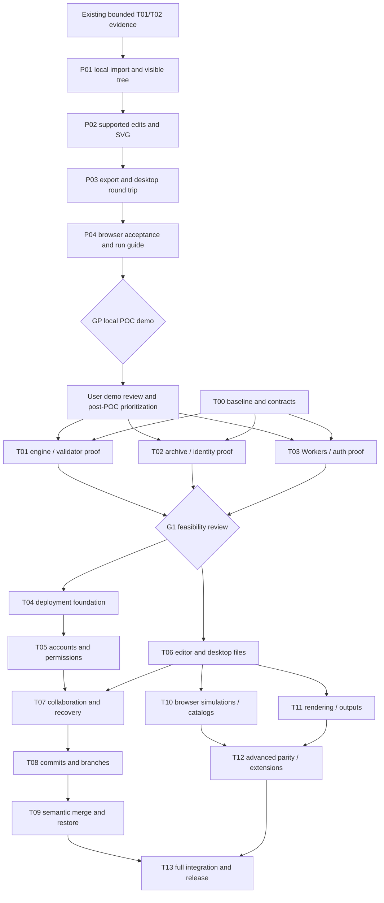

# Agent work plan

Read [the general agent guide](agent-guide.md), [scope and constraints](README.md), [decisions](architecture.md), and [acceptance matrix](parity-and-validation.md) before starting. This is a sequence of focused contributions, not one application-wide PR. The completed P01–P04 sequence in the [local editor POC plan](poc-plan.md) passed GP (see [acceptance evidence](poc-acceptance.md)), using a bounded early T06 editor and SVG portion of T11. The user has deferred accounts/auth and 100% feature compatibility until after GP. G1 remains held for the broader product, but its remaining research and T04/T05 do not block this local POC.

## Coordination rules

The integration agent owns contracts, architecture decisions, shared dependency changes, and merge order. Other agents own the paths and behavior in their assignment. Some paths below now contain isolated G1 proofs; consult their evidence before treating them as application infrastructure. Only one agent edits a shared schema, lockfile, Wrangler configuration, or Java facade at a time; request the coordinating agent to integrate changes there. Prefer isolated branches/worktrees and small PRs. Do not overwrite another agent's work or update desktop dependencies opportunistically.

Make focused local commits as coherent changes pass their appropriate checks and before handing off completed work. Do not push. Follow the general guide's staging and shared-checkout rules; commit hashes and actual verification outcomes belong in every handoff.

Every assignment starts by reading repository `AGENTS.md` and `CONTRIBUTING.md`, the relevant decision records, upstream symbols, and any closer directory instructions. Check open issues/PRs for duplicate work and link findings; the initial search was incomplete. Broad upstream changes need a maintainer discussion record before implementation, as required by repository guidance. This plan does not authorize agents to message maintainers or other people automatically.

The user has now authorized a local editor POC before full G1 closure and deferred accounts, auth and complete compatibility for that milestone. This is an explicit temporary scope exception, not an unrestricted rewrite or a passing G1. Retain existing proofs, failed evidence, pinned algorithms and later product goals. Add no compute service or unreviewed physics rewrite. The [POC plan](poc-plan.md) controls immediate acceptance; the full packets below describe post-POC work.

## Dependency graph and scheduling

P01 → P02 → P03 → P04 → GP is complete for the bounded supported inputs. Stop for user demo review before deferred implementation. Only fix T01/T02 behavior that directly blocks an advertised POC operation. Do not begin T03 closure, T04/T05, full T06/T11 or T07–T13 before the POC review unless separately requested. The following waves are the post-POC product schedule, not a requirement to organize agents or complete all feasibility first.

When parallel agent work is explicitly authorized, keep one coordinator and at most three implementation/research agents:

| Wave | Coordinator | Up to three concurrent assignments | Integration checkpoint |
| --- | --- | --- | --- |
| A | T00; fix contract ownership and fixture inventory | T01 engine, T02 codec, T03 runtime/auth after initial T00 contracts | G0/G1 evidence review |
| B | T04 build/deployment integration | T05 identity after T04 skeleton, T06 editor/codec, T10 simulation after T06 model contract | G2 foundation |
| C | Resolve shared contracts and integrate changes | T07 collaboration after T05/T06, T11 visuals, continued T10 numerical validation | G3 collaborative desktop round trip |
| D | Review history invariants and full feature ledger | T08 then T09 history, T12 advanced features, T11 remaining outputs | G4/G5/G6 |
| E | T13 release integration | Numerical/compatibility reviewer, security/recovery reviewer, browser/performance reviewer | G7 release evidence |

Dependencies still govern starts within each wave. A reviewer must inspect behavior and evidence, not merely agree with another agent's recommendation. Security and compatibility tests begin with their feature packets; wave E is final integration, not their first test pass.

## Work packets

For immediate implementation, the [P01–P04 packet table](poc-plan.md#ordered-work-and-stop-conditions) is authoritative. T00–T13 below retain the broader product responsibilities. Remaining T01–T03 investigations are deferred unless needed for the POC path; a complete T01–T03 exit is not a GP prerequisite.

### T00 — Integration agent: baseline, capability ledger, and contracts

Read `settings.gradle`, `build.gradle`, `core/src/main/java/module-info.java`, `BasicFrame`, `SimulationPanel`, and the current tests. Own `docs/web-app/`, the future `web/packages/contracts/`, shared workspace configuration, and the integration checklist.

Pin the desktop commit and supported browser policy. Expand the parity matrix to individual screens/actions/component types. Select representative `.ork` fixtures and expected semantic snapshots, including format 1.11 features. Establish the model schema, identity rules, command/result envelopes, codec API, engine facade, error representation, and protocol version negotiation before agents build against them. Record alternatives and unresolved semantics in decision records. Evaluate the existing browser port and upstream duplicate-work search; record reuse/licensing decisions and pin any reused sources.

Exit: every requirement maps to an owner and gate; fixtures trace to their provenance; contracts have examples for independent edits, conflicts, reconnect, and unsupported data. Do not claim full discovery from old feature-list documentation. No UI or simulation rewrite belongs in this packet.

### T01 — Engine agent: browser runtime and trusted reducer feasibility

Depends on initial T00 contracts. Own the future `web/engine-adapter/` and narrowly scoped core adaptation changes. Read `startup/Application`, `CoreModule`, rocket component setters/listeners, mass/aerodynamics packages, simulation steppers, motor database access, scripting, and extension discovery. Reuse/evaluate the candidate TeaVM port rather than copying its older engine blindly.

Build a reproducible Java-to-JavaScript facade and browser Web Worker runner; create a minimal validation/reducer entry point that executes in Workers. Generate versioned catalog resources at build time and inventory reflection/JNI/resources/desktop dependencies. Test actual setter side effects and configuration changes against JVM semantic snapshots. Measure startup, bundle size, runtime, cancellation, memory, and Worker validation CPU. Interleave two users/projects with different preferences to detect leakage from Java global state. Classify built-in extensions, expressions, scripts, and third-party plugin mechanisms by browser feasibility, with concrete blockers.

Exit: G1 has browser numerical comparisons, a real Workers command proof, full-state reducer comparisons, and a patch ledger. Include failures and missing features. WASM benchmarking or a TypeScript physics rewrite is a separate decision, not a prerequisite added without evidence.

### T02 — File-format agent: expanded archive and round-trip feasibility

Depends on T00 identity/codec contracts. Own future `web/packages/ork-format/` and interoperability fixtures. Read `GeneralRocketLoader`, `GeneralRocketSaver`, `openrocket/importt`, component/simulation savers, `DocumentConfig`, and format tests.

Implement bounded plain XML/GZIP/ZIP detection and expanded archive capture. Prove XML/opaque data preservation and versioned canonical serialization. Choose tested codec libraries; document limits and rejection behavior. Preserve component IDs, flight configuration references, web simulation identity sidecars, materials, decimals/units, images, decals, embedded motors, preferences, expressions, extension settings, and stored results. Emit standard archives with `rocket.ork` first and no web-only metadata. Preserve unchanged originals. Resolve duplicate IDs/paths and ambiguous desktop reimports explicitly.

Exit: G1 includes desktop → web → desktop and web → desktop → web comparisons, including a changed file with embedded motors/decals, unknown content, invalid imports, and sidecar loss on reimport. Show semantic field comparisons rather than merely checking that loading did not throw. Do not refactor desktop import/export code outside a concrete need.

### T03 — Platform/identity agent: Workers compatibility proof

Depends on initial T00 contracts; runs alongside T01/T02. Own an isolated runtime proof before the production foundation. Prove Hono/assets, SQLite-backed Durable Objects, WebSocket hibernation/reconstruction, private R2 access, D1 migrations, and Better Auth/Drizzle/admin integration. Test hashing and session operations under Workers budgets; do not substitute a Node server or local SQLite for the runtime evidence. Determine tested versions and compatibility date with a lockfile.

Exit: G1 has repeatable local runtime checks and, when deployment access exists, an isolated Cloudflare staging smoke test. If access is unavailable, mark remote platform validation pending and do not treat local emulation as proof of deployment. Record the exact first-admin bootstrap/recovery mechanism and admin capabilities to expose; leave production accounts/resources untouched.

### T04 — Integration/platform agent: deployable foundation

Depends on G1. Own future `web/package.json`, lockfile, Wrangler configuration, CI integration, migrations, and deployment/runbook sections. Integrate proofs into the agreed layout, including engine build artifacts and public source/license notices. Add separate local/staging/production bindings, secret setup, fresh-install migrations, health checks, version manifests, and documented build/deploy commands. Preserve the existing desktop build.

Exit: a clean checkout can build desktop and browser outputs independently; local integration passes; staging deployment is reproducible when credentials are available. Show no production dependency on Containers, external compute, native libraries, or a background JVM. Deployment work must report exactly which environments were actually exercised.

### T05 — Identity/admin agent: accounts and project access

Depends on T04. Own future `web/worker/auth/`, `web/worker/admin/`, project authorization helpers, and corresponding account/admin UI. Implement login/logout, password/account settings, operator bootstrap/recovery, user listing, role changes, suspend/reactivate, session revocation, and audit records. Implement project creation, owner/editor/viewer membership, sharing, ownership transfer, and last-owner/admin protection. Use the selected auth library; avoid incidental organization/billing features.

Exit: G2 proves two ordinary users and an admin, plus denied unauthenticated, viewer-write, cross-project, suspended-user, and privilege-escalation cases. Test open WebSocket revocation and in-flight races jointly with T07. Permission checks must protect HTTP, WebSockets, files, results, and history rather than only hide UI controls.

### T06 — Editor agent: single-user design and compatible files

The full packet depends on G1 model/codec/engine contracts. Its bounded POC slice is explicitly authorized earlier by [P01–P04](poc-plan.md), with no T04/T05, accounts/auth, structural editing or full-parity prerequisite. Own future `web/app/editor/`, component panels, units/material controls, and import/export UI. Implement the command-driven tree and property editor with selection, supported component add/remove/move, flight configurations, atomic gestures, validation messages, and local undo. Use server-ready commands from the start. Integrate T02 preservation and codec behavior; users must see unsupported or rejected edits and dirty/saved state.

Exit: representative designs can be created/edited/imported/exported and opened in the pinned desktop application. Cover component types in explicit batches; incomplete component coverage remains in the parity ledger. Exercise keyboard navigation, units/locales, validation, and recovery after a rejected edit. This packet establishes the editor increment; it does not establish all desktop UI parity.

### T07 — Collaboration agent: shared commands and durable recovery

Depends on T05/T06 and the trusted reducer from T01. Own future `web/worker/repositories/`, WebSocket protocol, collaboration client, and recovery tests. Use one repository object per design with branch subscriptions. Implement persisted command order/deduplication, transactional draft state, optimistic reconciliation, field preconditions, atomic graph edits, presence, reconnect/resync, undo conflicts, authorization, backpressure, schema negotiation, and hibernation recovery.

Exit: G3 proves two independent browsers editing one document, same-field and structural conflicts, disconnect/reconnect, duplicate/reordered messages, slow clients, object eviction, and deployment restart. No acknowledged command is lost or applied twice. Export the jointly edited file and verify it in desktop. Describe the retry/compaction window and stale-client recovery behavior explicitly.

### T08 — History agent: commits, refs, and branches

Depends on T07 and expanded archive snapshots. Own future `web/packages/history/`, repository history handlers, and history UI. Implement immutable blobs/trees/commits, author attribution, captured workspace sequence, durable prepare/publish/retry, atomic ref compare-and-swap, branch creation/switching, and revision download. D1 is only a directory projection. Reuse the existing repository object instead of introducing another consistency owner.

Exit: exercise two simultaneous commit attempts, edits during commit creation, branch separation, retries, and injected crashes before/after blob write and ref advancement. A failed commit may leave unreachable blobs but may not publish dangling refs or lose later edits. Show readable XML/asset diffs, not compressed-byte diffs. Git protocol or hosted Git synchronization is outside this packet.

### T09 — History agent: semantic merge, revert, restore, and recovery retention

Depends on T08. Implement three-way merge with common-base handling, stable IDs, binary/opaque conflicts, conflict resolution UI, full-model validation, two-parent commits, revert, and shared-workspace restore protection. Implement the recovery-branch rule for dirty drafts and workspace epoch changes. Specify reachability/retention and test safe garbage collection against in-flight snapshots and prepares.

Exit: G4 covers independent edits, edit/edit, delete/edit, tree/order conflicts, changed motor/decal assets, ambiguous merge bases/identity mapping, a moving target branch, and dirty shared drafts. Test a restored/merged export in desktop. No merge may report success by silently dropping an unsupported subtree.

### T10 — Simulation/catalog agent: browser numerical workflow

The user explicitly authorizes the bounded local [browser simulation profile](browser-simulation.md) after the editor extension. Full G1, T04/T05, hosted benchmarks and arbitrary desktop compatibility are not prerequisites for that slice. The rest of T10 and G5 retain their broader gates.

Depends on T01 and T06 model contracts. Own future `web/app/simulation/`, result/plot workflows, browser job scheduling, catalog integration, and numerical comparisons. Implement configuration/options, progress/cancellation, motor selection, atmosphere/wind/seed/stepper controls, event/warning display, plots, CSV output, result provenance, stale markers, and optional result upload. Integrate catalog data with version hashes and tested motor-curve semantics.

Exit: G5 covers representative single/multistage/cluster/recovery flights on JVM and browser, both current steppers, fixed seeds, warnings, cancellation, rerun, and edits during a run. Compare full relevant events/series and approved numerical tolerances, plus independent expected cases. Client results remain attributed and do not overwrite another snapshot's output. Do not add cloud simulation infrastructure.

### T11 — Visualization/output agent: 2D, 3D, and files users produce

The full packet depends on T06 geometry contracts. Only the small labeled SVG schematic in P02 is pulled forward for the POC; 3D and other outputs remain deferred. Own future `web/app/views/`, printing/Photo Studio, and export UI. Implement 2D views, CG/CP indicators, 3D geometry, picking, appearances/decals, camera controls, and Photo Studio. Add the desktop's supported PDF/template/part-list and CSV/SVG/OBJ/RockSim/RASAero workflows in individually reviewed increments, reusing core exporters where feasible. Preserve output scale, units, and format semantics.

Exit: G5/G6 evidence includes representative geometry and rendering comparisons, image export, measured print/template scale, and format round trips. Exercise keyboard/accessibility and supported browsers/GPU limits. Tag any Java tests requiring live OpenGL `requires-live-opengl`; browser tests still need actual browser rendering evidence. Do not put editable design originals into runtime Java resource directories.

### T12 — Advanced-feature agents: close the parity ledger

Depends on the G1 feasibility classification and T10/T11 integration. Split this work into focused feature packets rather than one speculative change: component/drag analysis, optimization, landing dispersion/Monte Carlo, custom expressions, built-in simulation extensions, scripting, third-party extension mechanisms, preferences/localization, and remaining export or component behaviors.

Each packet names its desktop entry points, engine dependencies, file fields, browser interaction, independent expectations, runtime/performance evidence, and remaining gaps. Implement script/extension execution only after the capability boundary and runtime semantics are established; preserve imported configuration safely in the meantime. Distinguish trusted built-in code from uploaded/untrusted code.

Exit: G6 requires a concrete acceptance record for every baseline capability. A plugin mechanism that cannot run under strict hosting is an unresolved requirement, not a reason to mark the row done. Raise the conflict with evidence and a proposed compatible alternative or explicit scope decision.

### T13 — Integration/verification agents: release readiness

Depends on G4/G5/G6 and their passing feature tests. Own deployment/recovery evidence and final traceability; use independent reviewers for numerical/compatibility, identity/data isolation, and browser/load behavior. Exercise fresh deployment, protocol/schema upgrades with connected clients, rollback, backup/restore across stores, and abandoned upload/commit cleanup. Measure room fanout, validator budgets, largest fixtures, history growth, and cost assumptions on the chosen Cloudflare plan.

Exit: G7 has reproducible commands and outputs, per-feature parity evidence, documented supported browsers/workload bounds, recovery results, and an operational runbook. Known failures and skipped checks are plainly recorded. Do not open production to users or claim parity based on screenshots, a green build alone, or another port's README.

## Required handoff from every agent

Provide a short connected report with the final change and rationale, owned paths, contract/schema changes, decisions added or superseded, exact tests run and outcomes, fixtures and their independent expected results, limitations/blockers, and the next ready packet. Include migration/recovery implications when state changes. Do not paste chat transcripts or report proposed tests as executed.

Before integration, review the entire diff, remove scratch/generated clutter, and keep each PR focused. Use the repository PR template with `# Description`, `# Testing`, contributor declaration, and `# AI assistance`; name actual runtime-supplied model identities or state that the exact identity is unavailable. An agent must not sign the human contributor's declarations on their behalf.
