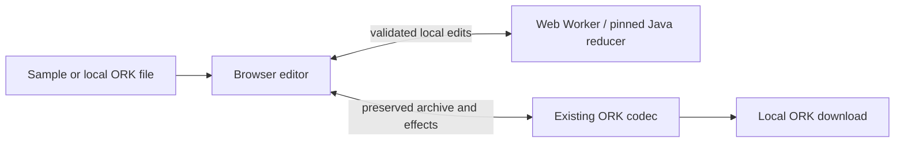
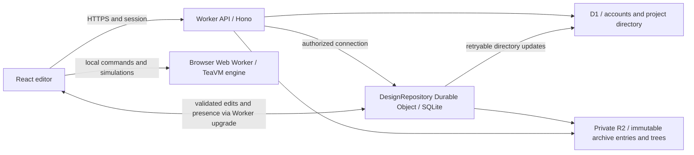

# Architecture and decision records

Read [the scope](README.md) first. These decisions are proposed for implementation, with feasibility conditions stated explicitly. Supersede a decision with its evidence and consequences rather than silently changing it. All production compute must remain in Workers or the user's browser.

Current priority: [ADR-15](#adr-15-deliver-a-local-editor-poc-before-full-g1-closure) and the [POC plan](poc-plan.md) authorize a local browser editor before complete G1 closure, with accounts/auth, backend integration and full parity deferred. [ADR-19](#adr-19-prepare-static-cloudflare-hosting-without-deployment) additionally authorizes preparing static Cloudflare hosting, stopping before deployment. Earlier blanket delivery holds apply to the post-POC product, not these bounded slices. G1 evidence remains valid and the gate remains held.

## POC runtime and data flow

One browser owns one in-memory document. There is no shared server authority, account or cloud persistence in this POC; the existing authenticated Workers endpoints are unchanged. UI success means a local edit or export was prepared, not that a shared revision was saved.

## Post-POC runtime and data flow

One project initially represents one desktop `.ork` design, with multiple branches. One `DesignRepository` Durable Object owns that project's branch workspaces, command sequence, refs, commits, and project access policy. WebSocket branch subscriptions are multiplexed within that object. This co-locates the operations that need atomicity. It avoids a distributed transaction between a room object and a separate history/ref object. A very busy project may become a hotspot; measure it before adding sharding. Projects scale independently.

D1 owns accounts, sessions, global user roles/status, and a searchable directory of projects. A directory row is a projection, not authority to read a design. The repository object owns project memberships and content access; private R2 blobs are accessible only through checked Worker routes. The diagram's direct API-to-R2 path is for authorized upload/download orchestration, never an unchecked content-hash lookup.

## ADR-01: Build a browser frontend beside the desktop application

**Decision:** Add `web/` without replacing `core/` or `swing/`. Use React/TypeScript/Vite for an application served through Workers Static Assets and Hono for its API. Use npm workspaces with one lockfile; leave desktop Gradle behavior intact. Integrate the browser engine through a narrow, versioned facade.

**Reasoning:** Swing dialogs and AWT/LWJGL canvases are desktop UI, while much of the rocket model and physics is reusable. A new frontend is substantial work, but remote desktop hosting would violate the compute constraint and would not provide native shared editing. A server-rendered framework adds little to an interactive CAD-like workspace.

**Consequences:** Browser equivalents are needed for forms, rendering, printing, and shortcuts. Reuse domain logic and resources where practical; do not translate entire Swing packages. Keep schemas in `web/packages/contracts`, engine integration in `web/engine-adapter`, and UI logic outside the Java physics packages. These are proposed paths, not existing code.

Evidence: [repository architecture](../source/dev_guide/architecture.rst), `settings.gradle`, `swing/src/main/java/info/openrocket/swing/gui/`, [Cloudflare Vite integration](https://developers.cloudflare.com/workers/vite-plugin/), and [Hono Workers guide](https://hono.dev/docs/getting-started/cloudflare-workers).

## ADR-02: Adapt Java physics at build time; compute simulations in the browser

**Decision:** Try TeaVM's JavaScript target first, compiling a deliberately bounded Java facade. Run it in a dedicated browser Web Worker with progress and cancellation. Build a smaller entry point for authoritative command validation/application in the Workers runtime. Evaluate Wasm only against measured JavaScript limitations and supported browser/runtime features.

**Reasoning:** Reusing algorithms gives a better chance of parity than independently rewriting the simulator in TypeScript. Workers cannot directly execute the desktop JAR. Wasm support alone does not supply a JVM, AWT, JNI, Graal scripting, or Java reflection. The Java dependency graph must be adapted regardless of output format. [TeaVM documents these adaptation requirements](https://www.teavm.org/docs/intro/overview.html); [Workers Wasm support](https://developers.cloudflare.com/workers/runtime-apis/webassembly/) is a runtime capability, not proof that this core compiles.

**Consequences and G1:** Demonstrate component construction/editing, mass/CG/CP calculations, motor lookup, seeded flight simulation, file behavior, and a minimal shared command reducer using this checkout's algorithms. Test the validator in actual `workerd`, not only Node. Document each shim and why it preserves behavior. Keep a patch ledger with upstream symbols and differential tests. Reflection-based service registration may need generated registries; replace native database access with a versioned build-time catalog export rather than changing motor interpolation. CI may use a JVM to generate artifacts and reference results; production may not.

`startup/Application` and `CoreModule` contain process-global injector/preferences/catalog state. Worker isolates may serve multiple projects; never swap singleton preferences per request. Prove interleaved project/user isolation and request-local document state. Independent simulation jobs also need isolated models/configurations/caches; `Simulation.duplicateForIndependentSimulation()` documents why ordinary shared copies are unsafe.

Evidence: `build.gradle` targets Java 17; `core/src/main/java/module-info.java` requires `java.desktop`, `java.scripting`, and `java.sql`, plus Graal, Guice, and ClassGraph; `core/build.gradle` includes SQLite JDBC. The existing [MMRocket Sim port](https://github.com/mtnmanak/mmrocket-sim) is a reuse candidate, not an accepted dependency. Pin and audit any reused revision, retain notices, and compare 24.12-to-26.11 changes. No code was copied in this task.

**Alternatives:** A TypeScript physics rewrite has greater numerical divergence and maintenance risk, so it requires a new evidence-backed decision if the adaptation fails. A production JVM service or Container is outside scope. Shipping an old engine and claiming current parity is unacceptable. Failure of G1 blocks dependent delivery until a feasible plan within the constraint exists.

## ADR-03: Server-authoritative domain commands for real-time editing

**Decision:** Send typed commands, not raw XML replacements or arbitrary JSON patches. Use a deterministic reducer with domain validation, shared where possible between browser and Worker. A command identifies protocol/schema version, project, branch, workspace epoch, operation ID, observed sequence, target IDs, and touched-field preconditions. The server supplies author identity, sequence, time, and accepted effects.

Initial commands cover setting a supported field, adding/removing/moving a component, changing flight configuration or simulation settings, and replacing an asset. Complex gestures are atomic command batches. Preserve the Java model's constraints and derived effects; a generic property assignment must not bypass setter behavior. The G1 validator must demonstrate this boundary. If it cannot, do not accept client assertions that a design is valid.

For example, `BodyTube.setOuterRadius()` can change automatic-radius state, clamp thickness, clear a preset, and propagate to configuration listeners. Preconditions/conflict detection must account for the full read/write effect set, including derived changes, rather than only the field named in the command. Compare complete semantic snapshots with JVM execution.

**Reasoning:** A rocket is an ordered, constrained component graph. Concurrent operations that converge at the data-structure level can still create cycles, invalid parents, or broken motor/configuration references. A central authority simplifies permissions, validation, durable acknowledgment, and history consistency. CRDTs such as Yjs are not selected for the initial structured model. Full offline editing is not a stated requirement; adding it later needs explicit conflict semantics. Simultaneous text editing inside one description field can be reconsidered separately if observed usage justifies it.

**Conflict behavior:** Edits to independent fields can both succeed despite an older observed sequence if their preconditions still hold. Two edits to the same field report a conflict instead of silently overwriting. A deleted target rejects a stale edit. Competing tree moves recheck cycle/parent/order rules. A duplicate operation returns its original acknowledgment. New commands may not refer to objects that their session has not observed or introduced in the same batch. Concurrent insertion order is deterministic and visible.

**Persistence:** In one SQLite transaction, save accepted effects, the resulting workspace change, sequence, and deduplication result before acknowledgment. Broadcast only committed changes. Use explicit serialization and revision rechecks around asynchronous authorization/blob work; JavaScript's single thread does not make an entire async request atomic. Rebuild from a durable snapshot and command tail after eviction. Compaction retains deduplication information for the declared retry window; expired clients must resync rather than replay blindly. Hibernation must not erase connection identity or branch subscriptions. [Cloudflare's Durable Object guidance](https://developers.cloudflare.com/durable-objects/best-practices/rules-of-durable-objects/) supports the coordination choice and highlights interleaving/persistence concerns.

**Client behavior:** Apply optimistic edits locally, reconcile with accepted effects, and visibly retain rejected edits for retry or manual resolution. Resume using workspace epoch and last acknowledged sequence; receive a snapshot if the tail was compacted. Connection loss must never be labeled saved. Presence and selection are ephemeral, branch-specific, and excluded from history. Show names and selection outlines as well as a colorblind-safe palette.

Undo creates a compensating command with current preconditions. It must not restore a whole old snapshot over another user's changes. A branch reset/restore increments the workspace epoch so queued edits cannot apply to an unrelated design state.

## ADR-04: Version expanded desktop archives with loss-aware XML handling

**Decision:** Persist immutable file trees containing the exact archive paths and entry blobs, including `rocket.ork` XML, images, decals, embedded motor files, and safe opaque entries. Retain the original upload as a recovery object. Maintain a parsed loss-aware XML representation and typed editing projection; serialize only supported changes while preserving opaque data. Do not make Java load-save the sole storage codec.

The authoritative workspace is the loss-aware archive/XML state plus its identity sidecar. The typed model/engine state is a derived projection. Accepted command effects must update the authoritative state and any persisted projection consistently within the repository transaction; do not maintain independent JSON and XML truths. Cached projections must be reconstructible and checked against the authoritative revision.

**Reasoning:** `GeneralRocketSaver.saveAllPartsZipFile` writes `rocket.ork`, optional `preview.png`/`thumbnail.png`, decals, and `thrustcurves/<digest>.rse`. Keeping XML alone would lose design dependencies. Current Java import handlers warn and ignore some unknown data, so a successful parse does not establish lossless serialization. `GeneralRocketLoader.loadStep1` accepts plain XML, GZIP, or ZIP and currently dispatches from the first ZIP entry. Export must put `rocket.ork` first, even when other entries are sorted.

The source of truth for behavior is `core/src/main/java/info/openrocket/core/file/`, particularly `GeneralRocketLoader.java`, `GeneralRocketSaver.java`, and `openrocket/`. The current saver emits format 1.11 unconditionally; do not infer working older-version export from its comment about choosing the oldest suitable version. The [format reference](../source/dev_guide/file_specification.rst) is useful but does not replace the implementation.

**Canonicalization:** Define a versioned serializer in G1. Normalize only known syntax proven insignificant. Preserve element order, numeric precision, units, text, comments, namespaces, and unknown subtrees where needed for meaning or preservation. Do not sort component children, strip arbitrary whitespace, or hash an engine's lossy reserialization as the imported truth. For an unchanged import, offer the original bytes; changed exports need semantic equality, not identical ZIP compression metadata. Canonical known XML enables readable diffs; opaque edits compare exact bytes.

Reuse desktop component UUIDs and flight-configuration IDs. Do not use tree positions, names, or flight-configuration IDs as simulation identities. Assign stable web simulation IDs and archive-to-model identity mappings in a sidecar stored with revision metadata, outside the exported archive. Preserve these mappings through app branch/merge operations. Reimport from desktop may lose that sidecar; reconcile only unambiguous matches and surface ambiguity.

For legacy files missing component UUIDs, allocate identities once at import in the sidecar and persist them in subsequent edited standard exports. Preserve the untouched original. Duplicate/ambiguous component IDs block editing until an explicit repair resolves all references; do not silently pick the first match.

**Unknown content:** Preserve opaque fields and archive entries, and reject structural edits whose impact on them cannot be established. Unsupported versions/components may be stored/downloaded in preservation mode with a clear edit limitation. This is temporary data protection, not a claim of feature parity. Do not execute imported scripts automatically.

**Import bounds:** Enforce upload and expanded-size, entry-count, XML-depth, image-dimension, and per-operation limits chosen from the fixture corpus. Reject duplicate/ambiguous paths, traversal, external entities, and decompression bombs. Validate/harden image display and treat unknown attachments as downloads. Select ZIP/XML libraries only after preservation, streaming, and Workers compatibility tests; this plan deliberately fixes the codec contract before the package choice.

## ADR-05: Git-style commit graph, separated from autosave

**Decision:** Use immutable blobs/trees and a commit DAG, with named mutable branch refs. A commit records parent commit IDs, expanded tree hash, identity-sidecar hash, author, server time, message, format/schema versions, and captured workspace sequence. Hash versioned, length-delimited canonical encodings with SHA-256 and object-type domain separation. Scope object access and deduplication to a project initially.

**Reasoning:** This provides snapshots, ancestry, branches, merges, diffs, and revert without shelling out to Git or presenting compressed ZIP changes. Git wire protocol, GitHub sync, and clone/push/pull are not required for the selected interpretation of “Git-style”; they are not claimed as delivered features. Keep the format exportable so a later actual Git backend can be evaluated without changing desktop files.

**Commit protocol:** Capture immutable workspace sequence S and expected branch head H. Write and verify required R2 blobs/tree, then atomically insert the commit, advance the ref, and update the draft's base commit/committed sequence in the repository object's SQLite transaction if H still matches. Preserve the accepted command tail after S as uncommitted workspace changes. A failed ref comparison returns a conflict; it never overwrites a newer head. Persist a prepare record and operation ID for retries. A crash before ref publication leaves unreachable objects, not a visible partial commit. A crash after publication returns the recorded result on retry. D1 directory updates are a retryable outbox projection, never the commit transaction.

R2 provides [strongly consistent object operations](https://developers.cloudflare.com/r2/reference/consistency/), but it does not provide a transaction with repository SQLite or D1. Immutable object keys and the publish-after-write protocol are deliberate. Garbage collection must trace refs, retained originals, active/prepared snapshots, and merge candidates, using a grace period and serialization with commit preparation; bucket age alone is unsafe.

**Branches and merges:** Every branch has a committed head and a durable shared working draft. Branch creation starts at a selected commit. Branch switching preserves each branch's draft. Named commits capture the shared draft, including collaborators' accepted edits, with attribution in the command log. Checkout/restore cannot silently discard a dirty shared draft: save it as a recovery branch or explicitly resolve it before replacing the draft.

Three-way merge uses the commit DAG's common base and stable entity IDs. Merge independent field/asset changes; report edit/edit, delete/edit, incompatible parent moves, ordering ambiguity, and concurrent binary replacement. Opaque XML uses byte-level conflict detection unless a proven codec rule exists. Ambiguous/multiple merge bases require an explicit merge-base strategy rather than an arbitrary choice. Validate the entire resulting model and attachments before publication. A merge commit has two parents; conflict resolution is itself reviewed against a fixed target head/workspace sequence. Any change to that target requires recomputation. Revert creates a new commit; restore preserves ancestry and recovery data. No automatic force-push/reset behavior is selected.

## ADR-06: Application accounts, project roles, and administrators

**Decision:** Use Better Auth, its Drizzle SQLite adapter, D1, and the admin plugin. Prove the exact integration in G1. Start with administrator-provisioned email/password accounts, account settings/password changes, and administrator-issued recovery flows. This meets the requested account management without making an external email or identity service a runtime dependency. Self-service registration/email delivery is an unresolved product extension, not a hidden hosting prerequisite. Avoid bespoke password hashing or session cryptography.

**Reasoning:** An established authentication library supplies account/session lifecycle and user management while staying within the selected runtime. A managed external auth server would add a service dependency; Cloudflare Access alone does not define application ownership, membership, or history authorship. [Better Auth's adapter](https://better-auth.com/docs/adapters/drizzle), [Drizzle's D1 support](https://orm.drizzle.team/docs/sqlite/connect-cloudflare-d1), and [Better Auth's admin plugin](https://better-auth.com/docs/plugins/admin) establish building blocks, not a tested integration for this app.

**G1 conditions:** Exercise login/logout, password hashing within Worker budgets, CSRF/origin checks, session expiry/revocation, schema migrations, and concurrent admin operations with real D1 behavior. Use secure HTTP-only same-site cookies. Do not store auth tokens in URL query strings or browser local storage. Disable impersonation capabilities unless separately justified. One-time operator bootstrap identifies the first admin explicitly; never make the first public signup an admin. Recovery tokens must be short-lived, single-use, and delivered through an authenticated operator workflow.

Roles are global `user`/`admin` and project `owner`/`editor`/`viewer`. Owners manage sharing and ownership transfer; editors edit/commit/branch/merge; viewers read/export. Site admins manage accounts, roles, suspensions, sessions, and operational audit records; the role does not silently confer private project access. Protect the last active admin and last project owner; require transfer or an explicit lifecycle action before account deletion. Disable/revoke first; preserve immutable historical attribution without exposing unnecessary personal data. Deletion/retention policy needs a recorded product decision before release.

Authorize every route, WebSocket handshake, command, commit/ref change, and asset/result download on the server. Reject cross-project IDs regardless of their validity elsewhere. Project ACL changes serialize in the owning object and close affected sockets. Check session/global account status using authoritative primary-backed D1 reads for commands; do not depend on an eventually consistent auth cache. If replicas are introduced, use [D1's session consistency controls](https://developers.cloudflare.com/d1/worker-api/d1-database/) deliberately. Define revocation's linearization point: in-flight operations already authorized may finish, but after revocation acknowledgment no newly authorized mutation may succeed. Test the race, including suspended users with open sockets. Failed checks fail closed.

## ADR-07: Keep simulations separate from trusted design state

**Decision:** Run browser simulations from an immutable input snapshot. Record tree/input hash, engine build, motor/material catalog versions, simulation options, random seed, and relevant extension/expression versions. Publish output as an optional derived artifact referenced by this provenance; current design and history remain independently editable.

**Reasoning:** Long numerical work would stall a collaboration object and consume shared server budgets. Browser jobs can progress and cancel independently. A result computed by a browser is untrusted as a scientific assertion even if its upload schema is valid. Label its author and provenance; do not present it as a server-certified result. Reject results whose project access or input reference is invalid. Mark results stale when inputs change and prevent a late completion from attaching itself to the current design incorrectly.

**Consequences:** Browser closure pauses/cancels work; unattended cloud computation is not available in this architecture. Parallel simulations/optimization use bounded browser workers and resume/checkpoint only if required by the existing workflow. Shared derived results may be cached by all relevant input/version hashes, but validation, size limits, and attribution still apply. Existing stored flight data, including external measurements, must survive import/export even when not regenerated; it is not automatically disposable cache. Server-side trusted numerical verification would require a separate decision and must fit Workers limits.

## ADR-08: Browser rendering and advanced-feature parity

**Decision:** Use SVG for 2D views/templates and Three.js/WebGL2 for interactive 3D, with geometry/model data derived from the engine adapter. Use browser PDF/print/download workflows as functional equivalents of desktop save/print dialogs. Keep animation/rendering separate from canonical model state; retain desktop-only appearance settings in the file codec.

**Reasoning:** The current renderer is in Swing, with AWT/LWJGL/OpenGL dependencies. It cannot simply become a browser canvas. Geometry, appearances, decal placement, clipping, picking, Photo Studio, transparent export, and model export all need explicit parity checks. UI colors must vary lightness and use labels/shapes as well as hue.

Scripting, custom expressions, built-in extensions, arbitrary third-party Java plugins, and local/native integrations are separate parity risks. `JavaCode` dynamically loads listener classes; `GraalJSScriptEngineFactory` permits unrestricted Java host access. Neither behavior transparently transfers to a TeaVM bundle or ordinary browser JavaScript. Custom expressions use a different evaluator and need separate tests. Preserve the desktop rule that untrusted imported scripts are disabled.

No arbitrary script/plugin may run with session/network/storage capabilities. A same-origin Web Worker alone is not a security sandbox: it can access origin resources. Investigate a separately isolated origin or a proven capability sandbox with controlled communication, network restrictions, trust prompts, cancellation, and resource bounds; its design and semantic compatibility remain open G1/G6 work. Preservation of plugin XML alone is not execution parity. At G1 classify each mechanism; at G6 every requested capability must have a working equivalent or an explicitly agreed requirement change. Do not silently redefine “full parity” to exclude hard features.

## ADR-09: Deploy and operate within measured platform budgets

**Decision:** Deploy Worker/assets, D1 migrations, SQLite-backed Durable Object migrations, and private R2 bindings through Wrangler and CI. Keep development, staging, and production data/secrets separate. Use structured logs for operation IDs, rejection reasons, reconnects, latency, errors, and resource usage without logging design contents or credentials. Avoid extra queues, KV caches, or workflow services until a measured requirement justifies them.

**Reasoning:** The selected application needs bounded synchronous editing and storage coordination. Background simulation infrastructure would add scope and violate the intended browser-compute boundary. Current [Workers limits](https://developers.cloudflare.com/workers/platform/limits/) include finite CPU, isolate memory, startup, and package budgets. Browser assets and the small validation entry point have different budgets; do not bundle the whole simulator into every server request.

**Release conditions:** Measure validator startup/CPU/memory, XML import/export sizes, room command rate, connections/fanout, history growth, and per-user/project storage cost on the target plan. Set documented limits from measured fixtures and desired workload. A slow collaborator must not create unbounded broadcast buffers. Record cost assumptions and forecast before selecting a production plan; no paid plan was authorized or provisioned by this task. Backups must cover D1, repository state, R2 blobs, and their cross-store references together. Restore exercises must establish consistent refs and retry pending writes; provider backups alone are not proof of application recovery. Use additive migrations/protocol negotiation, compatible rollout sequencing, and a tested rollback procedure.

## ADR-10: Keep the successful G1 subsets isolated until the remaining gate evidence exists

**Decision:** Retain executable proof packages beside the desktop build, with one npm workspace/lockfile and a separate TeaVM/ASM Gradle adapter. Keep the pinned current model/physics classfiles as inputs, a smaller server reducer entry point, and explicit startup/document/API bridges with a reuse ledger. Do not adopt the older port's complete numerical core. Keep file bytes/XML plus sidecar separate from the engine projection. The ordinary Worker has no operator setup route; disposable hosted testing uses a distinct protected, one-time harness and fresh storage bindings.

**Evidence and reasoning:** Current-core browser flights and Worker setters now execute, and an adapted-JVM diagnostic matches the original JVM transcript exactly for the covered fixture. Browser flights have small recorded differences, so compilation alone cannot establish parity. A lexical component-name edit preserves current archives through actual desktop loader/saver round trips. Better Auth with its separate Drizzle adapter, D1, private R2 and SQLite DOs passed local workerd and isolated hosted checks. This supports retaining the selected approach while holding G1 for missing preset/configuration/preference, catalog/extension, numerical and memory evidence.

**Alternatives and consequences:** A wholesale copy of the 24.12 port would change the baseline; a TypeScript physics rewrite introduces a separate correctness burden; a JVM service or Container violates the compute constraint. None is adopted. The existing port's GPL bridge patterns are explicitly attributed, and non-equivalent collation/defaults/plugins are listed rather than hidden. Protocol/codec version 1 applies only to the bounded interfaces; future compatibility changes need explicit migration decisions. No production schema or deployment foundation is established by these experimental SQLite tables.

**Runtime pins and budgets:** Tested versions are in `web/package-lock.json`, including TeaVM 0.15.0 in the isolated Gradle build, Wrangler 4.164.0, workerd 1.20261117.1 and compatibility date 2026-11-17, Better Auth/adapter 1.7.25, Drizzle 0.45.4, Hono 4.13.19, fflate 0.8.3 and saxes 6.0.0. The installed Cloudflare test integration is `@cloudflare/vitest-plugin` 1.8.4 with Vitest 4.1.12. Hosted password login used 117–166 ms CPU with default hashing, so a 10 ms CPU budget is not established. Do not reduce the hash work factor to fit that budget. Heap measurements and dependency advisory resolution remain pending before delivery. Exact commands, failed inputs and cleanup evidence live in the [combined record](g1-feasibility.md) and package READMEs.

## ADR-11: Review two file-I/O fixes without changing the numerical baseline

**Context and decision:** The supplied real-world rocket exposed warning-type data loss and RSE numeric rounding that invalidates embedded motor digests. Apply the narrow desktop fixes `40dd387ce` and `3648d87bd`, with regression tests, while retaining the original numerical baseline. The engine build checks exact SHA-256 values for those two files and continues rejecting differences in every other core source. Its manifest explicitly records the baseline and reviewed file/commit hashes; the desktop proof also records these source hashes. This is the necessary integration delta for the requested bug fixes, not a wholesale baseline upgrade.

**Evidence and alternatives:** Both warning-name cases and all four new precision cases failed before their respective fixes; 47 relevant core tests pass afterward. The browser/reducer artifact hashes and complete numerical JVM transcript remain identical to the original proof, and Chromium/workerd assertions pass. Negative probes confirm the pin rejects edits both inside and outside the reviewed files. Dropping source checks would hide future changes; changing the desktop reference without this delta review would obscure comparisons. Neither alternative is adopted. Details are in [the compatibility evidence](../../web/packages/ork-format/README.md#warning-and-motor-precision-fixes).

**Consequences:** Previously rounded motor archives still require the original matching motor source/catalog to recover lost precision. No fuzzy digest match or unverified motor substitution is introduced. Desktop saves may emit different RSE bytes, so the proof records their hashes and verifies numerical motor equivalence; web archive edits continue to preserve attachment bytes exactly. G1 remains held for its other documented gaps.

## ADR-12: Bound imported preset and configuration effects to explicit supported projections

**Decision:** Extend the existing G1 Java reducer and authenticated archive transaction with two actual preset catalog records and one parachute deployment reset. Reconstruct request-local core objects, run original methods, and preserve XML outside accepted effect spans. Unknown catalog digests, automatic geometry dependencies in the preset path, incomplete/opaque deployment overrides and unresolved configuration references refuse the operation. The strict source pin and two exact I/O exceptions remain unchanged.

**Evidence and scope:** The [executable proof](../../web/platform-proof/README.md#imported-preset-and-configuration-proof) compares actual attached desktop presets and the desktop recovery-reset action with workerd, including complete relevant states, targeted configuration modification IDs, full desktop serialization and lexical archive preservation. A preset digest build failure required an MD5-only `MessageDigest` compatibility bridge; JDK/Node/workerd vectors and real factory-validated records check it. Its classfile remapping is a recorded adapter change, not a desktop source edit or relaxed digest check. The missing computed-thickness failure is retained as well.

**Alternatives and consequences:** A preset-present flag would miss actual load/clear semantics; changing only an override field would miss inheritance and event scoping. Neither is used. A full imported graph/catalog/startup adaptation remains a larger investigation. This bounded implementation keeps globals immutable and production within Workers/storage; simulations remain browser work. Mutable preference isolation, general extension execution, other configuration operations and hosted CPU/heap budgets remain open, so G1 stays held.

## ADR-13: Prove one automatic geometry dependency without accepting desktop reload drift

**Decision:** Extend the existing request-local reducer with an explicit BodyTube/direct CenteringRing dependency: automatic outer radius, explicit inner radius, centered single instance and TOP position. Preserve the ring's automatic XML token and carry derived Java geometry separately in accepted effects. Continue requiring complete archive/precondition checks and the original atomic revision/deduplication publication path.

**Evidence and reasoning:** The pinned `RadiusRingComponent.getOuterRadius` queries the parent inner radius at the two clamped ring ends. For a cylindrical BodyTube these values are identical; explicit inner radius avoids sibling `InnerTube` lookup. Comparing the actual document with workerd therefore needs this bounded parent/child projection, ring intrinsic/position/instance facts and configuration IDs. The [proof](../../web/platform-proof/README.md#automatic-centering-ring-proof) checks primed/repeated geometry reads, complete relevant state, independent cylinder expectations, root/configuration events, full desktop XML, lexical preservation and desktop save/reload.

**Failure and alternatives:** A real underfit edit leaves live outer automation enabled, while desktop reopen disables it and changes the serialized radius. The retained control requires rejection before publication. Rewriting the ring's automatic token or silently substituting geometry would hide that difference. A core loader change needs a separate reviewed baseline decision; no such change is made here. All other automatic graph shapes remain outside this supported subset. Process-global preferences remain immutable, scripts/simulations do not run on the server, and hosted CPU/isolate heap remain unmeasured. G1 remains held.

## ADR-14: Include the sibling and absolute-position prefix in automatic-inner proof inputs

**Decision:** Extend the existing G1 request-local Java scene with one explicit sibling InnerTube and the preceding nose-cone length for a both-automatic CenteringRing. Keep TOP single-instance ring/sibling positioning, one direct active axial stage and a zero-position root. Reject other graph shapes until proven. The archive projection adds these read-set preconditions; Java executes the pinned relative-position, overlap, sibling-radius and cap methods. No geometry algorithm is added to production TypeScript.

**Reasoning and alternatives:** The getter includes exact endpoint contact and caps the sibling radius at the parent-derived outer radius. `toRelative` subtracts absolute component locations; omitting a common prefix can change floating-point boundary classification. Body components force AFTER positioning through `SymmetricComponent.isAfter`/`setAfter`, so forcing the tube to TOP is not a desktop-valid way to remove that prefix. Reconstructing the explicit preceding nose cone preserves the actual arithmetic. Copying the overlap algorithm to TypeScript or accepting arbitrary ancestor graphs without their read set would leave this behavior unproved.

**Consequences:** The existing explicit-hole underfit failure/refusal remains. Both-automatic cap inputs are tested independently through authenticated publication and desktop serialization/save/reload, with annular-cylinder expectations and repeated core reads. Preferences stay immutable; arbitrary defaults, graphs, catalogs/extensions and hosted CPU/heap limits remain open. Source pinning, the two exact I/O exceptions and catalog/motor digest checks are unchanged. G1 remains held; the executable evidence and reproduction commands live in the package READMEs and feasibility record.

## ADR-15: Deliver a local editor POC before full G1 closure

**Context and decision:** On November 18, 2026, the user explicitly prioritized a basic editor and deferred accounts, authentication and 100% feature compatibility until after it. Reuse the proven Java/codec subset to deliver P01–P04 and the independent GP acceptance gate in the [POC plan](poc-plan.md). Start with a visible sample/file tree, then name/radius edits, an SVG schematic and export/reopen. This temporarily supersedes ADR-02/ADR-10 and earlier scheduling statements wherever they block this bounded editor until all G1 work is finished. G1 remains held for the broader product.

**Scope and alternatives:** Choose browser memory and local files, with Java-derived edits in a browser Web Worker. Keep the existing React/TypeScript/Vite direction and SVG for the minimal preview. Defer Workers app integration, D1/R2/DO persistence, auth/admin, sharing, history, simulations, 3D, catalog editors, structural editing and advanced parity. Completing all geometry/extension/budget research first would delay the requested demo; removing checks from authenticated endpoints would unnecessarily create a different access model. Neither is required for the local POC.

**Consequences and validation:** The future hosted product still needs server authority, accounts and its recorded gates. No backend proof is deleted or converted to anonymous access. No production compute exception is granted. Supported POC edits must retain pinned methods, digest/source checks, opaque data and unsafe-edit refusal, with actual browser and desktop round trips. GP proves only the named local workflow; it does not prove hosted budgets, general compatibility, simulation correctness or production readiness. Deferred capabilities retain their owners and later gates. This planning decision does not claim that the UI or GP checks already exist or pass.

ADR-15 implementation evidence, November 18, 2026: P01–P04 and GP passed for the bounded inputs in a clean isolated checkout. The [acceptance record](poc-acceptance.md) documents the actual UI downloads, Java Worker edits and pinned desktop round trips. This implements the selected boundary without changing it; G1 remains held and further implementation waits for user demo review.

## ADR-16: Extend the local editor with a Java exterior drawing and tube dimensions

**Decision:** Following user review of GP, add a selectable SVG exterior view and BodyTube length/wall controls while retaining local memory/files, the dedicated Java Worker and the pinned core. Reconstruct one bounded axial exterior scene in Java, use actual core curve/position/fin getters, and return polygon vertices to the UI. Unsupported shapes/graphs are omitted or rejected explicitly. Keep the existing radius/ring adapter intact; additional scalar edits refuse automatic descendant geometry.

**Evidence and consequences:** Chromium SVG vertices match the actual desktop-loaded sample and rich fixture, with independent sample extents and keyboard/pointer selection checks. Length/wall UI downloads match actual desktop setters, complete relevant state, full serialization and save/reload, with opaque content/series preserved. A Java functional modification-ID flag carries setter-event invalidation even when clamping leaves the final wall unchanged. Density-only XML editing failed material-metadata/catalog-history comparisons and is not exposed. This is a bounded extension, not a general Java importer, material editor or passing G1. See [the extension record](editor-extension.md).

## ADR-17: Add one archive-bound browser flight profile in a separate Worker

**Decision:** The November 18 follow-up explicitly authorizes a bounded local T10 slice before broader G1 closure. Reconstruct one desktop-generated single-stage model from the authoritative accepted archive, including its internal mount, verified synthetic motor and parachute. Use a sealed field/topology profile to refuse any unrepresented behavior. BodyTube dimensions and component names vary; other physics/configuration/material/override/extension changes require separate support. This supersedes earlier simulation deferrals only for this local increment. Keep the original synthetic `EngineProof.flight` proof distinct.

**Boundary:** The document Worker captures an immutable archive snapshot and provenance using the existing contract. A separate disposable flight Worker reimports and validates it, reconstructs the model and runs the pinned Java event engine, RK4/RK6, motor interpolation, mass, automatic recovery geometry and aerodynamics. No reducer/server simulation export is added. A monotonic job token, worker identity and exact input hash guard publication. Killing a flight Worker leaves the document Worker and accepted archive intact. Old-input completions remain labeled stale; new jobs supersede old ones. Units affect presentation only.

**Consequences:** New results remain attributed session-local data, never exported flight data. Settings are bounded/read-only except stepper. The model hash, exact archive bytes/identity, settings/seed, material/motor data and engine artifact bind each job. A general Java importer/catalog/extension runtime would exceed this slice; unrepresented fields refuse simulation while existing archive preservation remains available. The new incremental MD5 bridge surface serves the pinned `MotorDigest`; no motor/digest fallback is introduced. Validation, supported limits and numerical evidence live in [the simulation record](browser-simulation.md). G1 and G5 remain broader held gates.

## ADR-18: Reconstruct a bounded imported flight graph and retain historical simulations separately

**Decision:** The user identified `example rocket.ork` after the original profile rejected its saved simulations. Add a field-checked single-stage importer for the component/mass/recovery cases it needs, using native Java setters, configuration/override objects and the pinned curve normalizer. Keep the original synthetic path and tolerances. Historical simulation conditions, series and custom output expressions are opaque preserved data; a new session uses the explicitly displayed bounded settings. Imported extensions/scripts remain refused. One explicit archived default configuration is runnable; 1–16 configuration references are reconstructed/verified, with one motor mount and one or two parachutes.

**Motor/preset identity:** Reuse the pinned core digest compatibility checks, without fuzzy matching. An exact two-record public catalog supplement resolves J135W/J800T references whose older embedded RSE data lost precision. Its source database and exported bytes are hash-checked and the UI identifies the catalog source. Existing archive entries/assignments are never rewritten or replaced. The PAR-36 public preset is factory/digest checked. Java still performs all motor interpolation, automatic geometry, mass, aerodynamics and stepping. No simulation enters the reducer/server endpoints.

**Identity and validation:** Snapshots now carry the accepted identity sidecar into the separate flight Worker. Reimport validates that sidecar against exact bytes; freshness includes its hash, so reimporting identical archive bytes cannot adopt the previous document's identity. Independent fixtures cover both steppers, overrides, transitions/internals, dual recovery, saved settings, unknown data preservation and edits, using the original strict numerical limits. The actual user file is a separate read-only diagnostic, with larger recorded RK6 adaptive-grid differences; it is never a source fixture or broad numerical acceptance. See [the follow-up evidence](imported-browser-simulation.md). G1/G5 remain held.

## ADR-19: Prepare static Cloudflare hosting without deployment

**Decision:** The November 19, 2026 user request authorizes preparing the current browser editor for Cloudflare and explicitly stops before deployment. Add an independent assets-only Wrangler config in `web/app/`, reusing the workspace's pinned Wrangler and compatibility date. Build the existing Java/TeaVM engine and Vite output locally, validate with `wrangler deploy --dry-run`, and exercise the actual assets through local Wrangler/workerd and Chromium. The [runbook](cloudflare-deployment.md) records commands, evidence and the later manual deployment boundary.

**Reasoning and alternatives:** Workers Static Assets serves the existing browser application without a server bundle. Editing and simulation already run in separate browser workers; moving them to an API or integrating the authenticated D1/R2/DO proofs would add behavior outside this request. A second Pages deployment model or Cloudflare Vite plugin adds no required capability to this static build. Java/Gradle and the pinned Git baseline are required during build, so prepare locally rather than assuming Cloudflare's managed build image supplies them.

**Consequences:** The assets can be published later as a browser-local editor, with no app secrets, database migrations or cloud project state. This is a bounded T04 hosting preparation exception to earlier hosted-work deferrals, not delivery of the multiuser foundation or passage of G1/G2–G7. Existing proof authentication stays intact. No Cloudflare login, resource provisioning, deployment, DNS changes, automatic deployment workflow or Git push is authorized by this request. Hosted behavior remains unverified until the user authorizes that next step.

## ADR-20: Select an existing flight configuration for a session run

**Decision:** The November 19 user request authorizes a selector for the existing bounded imported configurations. Keep the choice in the document Worker's session state, separate from archive bytes and the archived default. Populate labels with archived configuration names, motor designations and ejection delays. Carry the chosen ID explicitly through snapshot capture, provenance rebinding in the independent simulation Worker and the Java model. Reconstruct optional configuration names through native setters. An import resets selection to its archived default; edits and unit switches retain the session choice.

**Consequences and validation:** Freshness compares configuration ID as well as archive, sidecar and stepper. Changing selection during a flight leaves its captured input intact; an older completion is stale and superseded jobs cannot publish late results. Configurations with no motor refuse visibly without substituting another configuration. Selection never invalidates imported stored series or changes exported bytes. Independent J135W/J800T fixtures compare full reconstructed configurations, both steppers, recovery overrides and an edited rerun against the JVM under unchanged limits. [The selection record](motor-configuration-selection.md) gives commands and evidence. The user moved development to a local disk checkout; no NAS or temporary worktree migration is performed by the agent. G1/G5, configuration editing and broader compatibility remain outside this increment.

## ADR-21: Run a selected saved simulation and expose the bundled motor catalog

**Decision:** The November 19 follow-up authorizes saved-row selection/running, graphs and all bundled motor options. The user explicitly selected saved settings where supported. Use existing sidecar simulation UUIDs and archived conditions/configuration links; capture these in the independent flight Worker snapshot/provenance. Reconstruct validated saved options through the pinned Java setters and `toSimulationConditions()`. Retain the original bounded manual flight path. Saved unsupported settings refuse rather than substituting manual defaults; unspecified seeds use the displayed deterministic 42 without archive mutation.

**Catalog and archive boundary:** Generate all 1942 curve options from the pinned desktop SQLite reader/RSE writer at build time, with metadata and hash-addressed same-origin curve assets. Browser selection updates an explicitly chosen existing mount/configuration through atomic lexical replacement, targeted stored-result invalidation, verified curve embedding and codec reimport before publication. No live catalog service, new physics implementation, global preference mutation or desktop core change is introduced. Original stored series remain separate from session results. The [workflow record](saved-simulations-and-motors.md) documents supported settings, refusals, preservation and independent desktop/catalog verification.

**Consequences:** This supersedes the earlier fixed-session-settings and two-reference catalog limits only for the authorized local workflow. Source/digest checks and G1/G5's broader held status remain. Full graph/settings parity, catalog updates, structural editing, accounts/collaboration and deployment require separate work.

## ADR-22: Catalog-only motor editing and a saved-simulation configuration lifecycle

**Context and decision:** The user explicitly requested removing extra flight-tab content and the Session flight row, using only the catalog with OpenRocket’s filters, and implementing New/Rename/Delete configuration with an automatically linked simulation. Replace the manual UI with the document’s saved rows and compact run/plot/cancel controls. Retain the engine’s internal manual path for existing proofs. Build native manufacturer aliases, motor-set groups, rounded set impulse, availability and curve similarity with desktop classes alongside the catalog; do not approximate motor correlation in browser code. Browser predicates retain desktop impulse/diameter boundary semantics and mount limits.

**Archive contract:** New configuration chooses a catalog motor/name first, then atomically appends a UUID configuration, its motor assignment and verified curve, and a saved simulation linked by configid. Initial conditions explicitly save the established deterministic defaults (RK4, seed 42, 0.05 s step, vertical 1 m rod, 28.61°/-80.60°/0 m site, average 1 m/s wind with 0.1 m/s deviation, ISA/WGS/spherical, 600 s maximum). Existing simulations retain their settings/data and are marked outdated as observed with the native lifecycle. Rename changes only the configuration name. Delete removes every linked simulation and native component configuration reference; unknown references refuse. If the archived default is deleted, use the first remaining configuration; deleting all leaves an empty list from which New can recreate a default. Creation requires one axial stage, an existing mount and fewer than 16 configurations.

**Identity and validation:** Adjust the sidecar simulation UUID list in the same transaction as XML additions/removals, preserving all surviving UUIDs. Reimport and describe candidates before publication; stale hashes, failed curve integrity or unsupported references retain the previous archive. Native lifecycle/setters plus complete native serialization/reopen are the configuration oracle. Actual browser runs of the new saved row are compared with native saved options without widening existing numerical limits. This avoids both a synthetic session row and relinking simulations by index after mutation. Results remain browser-only. No new dependencies, core physics, hosted compute, live catalog update, collaboration or deployment are introduced. See [the configuration controls record](configuration-controls.md) for evidence and limits.

## ADR-23: Native component creation, static drawing centers and expanded units

**Decision:** The user explicitly authorizes structural creation, CG/CP drawing markers and simulation unit selection. Export the pinned native constructors/savers and parent compatibility at build time instead of hand-writing component defaults or porting the general reflective Java loader. Preserve the existing palette and open the existing editor after creation. Insert body components after the selected body component or at the end; append other compatible children and stages. File New creates an empty axial stage. Only tube-fin wall initialization deliberately differs from its undefined native constructor value, using the native BodyTube default wall.

**Boundary:** Structural commands capture the archive hash and selected component, insert a fresh UUID, update stage configuration references, invalidate stored results, and pass archive export/reimport plus view construction before publication. Existing XML/assets/series and simulation sidecar identities remain intact. The existing property-editing limits and 64-component cap remain. Do not infer full component editor or simulation compatibility from successful creation.

**Static calculations:** Use the existing field-validated Java reconstruction in a separate analysis mode, retaining the strict flight path. It permits no motor/recovery/configuration for unfinished designs, optional native geometry defaults, and explicitly supported additional single-stage component types. Native launch mass gives CG; Barrowman worst-angle CP uses Mach 0.3, zero AOA and roll, as in desktop. Undefined centers and unsupported inputs have explicit unavailable states. Unknown behavior is never skipped to produce partial centers. Freeform geometry and multistage/pod graphs remain unsupported for stability/drawing. A general importer or port of AWT geometry would expand this bounded slice unnecessarily. Simulations remain in their independent Worker; the document Worker uses only the static calculation export.

**Presentation and evidence:** Add labeled distinct CG/CP symbols, and share exact SI length factors across result tables, plots, rulers and dimensions for mm/cm/m/km/in/ft/yd/mi. Unit selection changes presentation only. Native complete creation/save/reload, static-position comparisons, browser interactions and unchanged-byte checks are the acceptance basis. See [the extension record](component-creation.md) for supported behavior and actual verification. No core numerical algorithms, global preference mutation, dependencies, deployment, accounts or collaboration are introduced. G1/G5 remain held.

## ADR-24: Editable imported values and native component tree actions

**Decision:** The user explicitly requests every displayed Imported properties value to be editable, working Move up/down/Duplicate/Delete controls, and smaller unlettered CG/CP symbols. Retain the established quick controls and add per-field archive editors with full text and existing attributes. Generate field kinds/enumerations/special tokens from the pinned desktop setter registry at build time; do not add a runtime JVM or general reflective loader. Validate field syntax, keep native aliases synchronized, reuse proven Java tube clamps/ring validation, and preserve the accepted archive on failure. Raw archive editing is broader than the bounded rendering/flight projection; it does not certify arbitrary setter effects or full numerical parity.

**Tree and archive contract:** Move adjacent siblings as subtrees, append deep duplicates with fresh component IDs, and delete with stable nearby selection. Protect the root and last axial stage and retain the 64-component bound. Stage activeness follows UUIDs, with native first-stage activation if none would remain active after deletion. Recognize native cannot-run/aborted/not-simulated states for the new component actions; invalidate previously current stored results without rewriting settings/series/assets. The older radius proof's narrower status contract stays unchanged. All commands guard the accepted archive hash and publish only after export/reimport and view construction.

**Alternatives and evidence:** Leaving new automatic tubes and non-tube parts behind disabled legacy controls does not meet the request. A complete Java importer or every desktop configuration dialog would expand the slice substantially. Explicit editable archive fields provide the requested values while preserving unknown content and the existing engine refusals. Actual desktop setters, tree operations and save/reload plus independent lexical preservation and browser interactions are the acceptance basis. Desktop deletion itself normalizes retired source references/derived warning labels and unused material registrations; the deletion oracle isolates that known boundary while requiring exact browser archive history and preferences. See [the editing record](component-editing.md) for scope, validation and handoff. G1/G5 and broader product gates remain held.

## ADR-25: Screenshot-guided component dialogs and independent field units

**Decision:** The user's body tube, nose cone and fin references replace the default raw grid with native-style property tabs, numeric/unit/slider rows, material groups and Cancel/OK. Reuse native constructor/enum/material metadata at build time. Keep the complete scalar editor and established tube proofs under Advanced. Omit the excluded parts library and unsupported split/freeform-convert/3D dialogs. The Motor tab navigates to the existing configuration controls. Other component types retain their scalar controls in the common compact layout.

**Editing and units:** Each measured field owns its session unit choice and exact canonical draft, independently of other fields. Unit-only changes never mutate the archive. Explicit dimension mappings cover length, archive-degree angles, mass, densities, time and shear modulus; dimensionless/text values get no fictitious units. Diameter/inner-diameter/sweep-angle controls use the native relationships. OK atomically applies known scalar edits and a name change to a private candidate under the accepted hash/UUID precondition, and publishes only after reimport/description. A finite optional-field allowlist enables the shown tabs without adding a nested XML editor. Cancel/close discard drafts. Advanced retains individual Apply. Existing series/assets/identity and invalidation protections remain.

**Evidence and limits:** Native unit/setter plus serialization/reload comparisons, independent SI expectations, unchanged bytes, real browser interactions and reference/phone screenshots are the acceptance basis. Screenshot similarity alone cannot prove conversions. Runtime physics, hosted state and general parity remain unchanged; see [the dialog record](component-dialogs.md) for actual checks and the remaining limits. G1/G5 remain held.

## ADR-26: One username-only shared draft before accounts and history

**Decision:** The November 20 user request authorizes one shared-file coediting POC with display usernames and explicitly excludes accounts, logging and version history. Route all visitors to one SQLite-backed Durable Object through a same-origin WebSocket endpoint. Reuse the existing archive commands and smaller Java reducer on the server, persist only the latest archive/identity/filename, then broadcast it. Keep simulations and view/stability construction in browser Workers. Existing authenticated feasibility proofs stay separate. No deployment is authorized by this implementation request.

**Alternatives and scope:** BroadcastChannel would share only one browser, and client-generated replacement snapshots would bypass trusted commands. A complete project/account/history protocol would exceed the requested POC. Use a conservative whole-draft token: simultaneous submissions against one state accept one and visibly reject the stale one, even for independent fields. Automatic command replay, optimistic edits, command logs, undo, branches, authenticated attribution and full field-level merging from ADR-03 remain deferred. The internal token is a concurrency precondition, not user-visible version history. Plain Vite still supports the prior browser-local workflow; Wrangler enables shared mode.

**Consequences and evidence:** Save the current snapshot in chunked storage within one transaction before acknowledgment; restore it after restart/hibernation, with usernames attached to active sockets. Reconnect fetches current state without replaying unknown-outcome edits. New/Open replaces the shared file for every visitor. External updates retain component drafts and refuse saving a stale dialog until it is reopened; motor and insertion pickers close. The [coediting record](coediting-poc.md) documents the protocol, local runtime tests, limitations and run commands. The app's previous assets-only Wrangler configuration is now a Worker/assets/DO configuration; deploying later would create that binding. G1 and the broader product gates remain held.

## ADR-27: Cloudflare D1 accounts and multiple public owned rockets

**Decision:** The November 20 follow-up authorizes real accounts and multiple documents owned by each account. The user clarified that every signed-in account may coedit every public rocket, with sharing permissions deferred. Promote the proven Better Auth/Drizzle/D1 combination into the app, adding the official username plugin for normalized URL identities and signup/sign-in. Store account/session and rocket-directory ownership data in Cloudflare D1, and route each immutable rocket UUID to its own existing `SharedRocket` Durable Object. Public paths are `/<username>/<slug>/`; visitors may inspect/download and use local simulation, while writes require a live account session. This supersedes ADR-26's username-only singleton boundary without adopting the full T05/G2 account/admin/ACL packet.

**Reasoning and alternatives:** A standalone SQLite file or database process contradicts the requested Cloudflare storage boundary. D1 uses SQL through its managed binding; Drizzle's SQLite dialect is not a local storage implementation. Reuse the pinned, already-proven auth library rather than introducing password/session cryptography. Retain DO current-draft storage and trusted commands, avoiding a second archive authority or an unneeded R2 migration. Bind ownership to the creating session, not supplied IDs. Use database uniqueness per owner/slug and server-derived socket identities; recheck session validity before applying and just before persisting commands. New rockets initialize lazily as native empty named designs.

**Consequences and evidence:** All documents are public and every authenticated user is an editor; ownership is metadata rather than a sharing policy. Account/URL changes, deletion, recovery emails, admin management and version history remain deferred. Preserve the old singleton without assigning it to an arbitrary account. Production requires a stable auth secret and exact HTTPS origin; the deployment helper applies remote D1 migrations and uploads that secret over stdin with the Worker. The dedicated remote D1 database is actually created/migrated and its empty schema verified, while the app remains undeployed. The [account record](accounts-and-rockets.md) contains commands, auth/revocation boundaries, local Chromium/D1/DO evidence, deployment requirements and remaining hosted limits. G1 and broader product gates remain held.

## ADR-28: Name-only rocket creation and validated archive upload

**Decision:** The subsequent November 20 request hides path selection during creation and adds upload of an existing rocket. The UI collects a name and an empty/upload source choice. Generate a bounded URL slug on the server, with unique numeric suffixes for repeated names and database-enforced race checks. Preserve existing explicit-slug API behavior. Use bounded multipart input for uploads through the existing authenticated creation endpoint, without a new dependency, storage service or schema migration.

**Publication boundary:** Validate and persist the original archive in a fresh Durable Object before inserting its public D1 metadata. Initializing an empty document first and subsequently sending a browser import could expose the wrong file to collaborators or leave a blank document after a rejected upload. Binding-only initialization and guarded cleanup keep these operations off the public socket path. Failed uploads publish no metadata; ordinary metadata failures request cleanup. Cross-store crash recovery/abandoned-object collection remains outside this slice. Uploaded names, bytes, opaque assets and simulation identities retain the existing codec contract.

**Evidence:** The [creation/upload follow-up](accounts-and-rockets.md#creation-and-upload-follow-up) records the actual UI, concurrency, exact-byte/asset, invalid-file, authorization and restart checks. Cloudflare D1 still owns metadata and per-rocket Durable Objects own archives. Existing account/coediting limits and broader held gates remain; no deployment or remote data migration is performed.

## ADR-29: Confirmed deletion and one protected administrator

**Decision:** Replace the creation source dropdown with separate scratch/upload cards, allowing file selection or drop. Add owner-authorized rocket deletion and the explicitly requested new `admin` login, initially `admin`, with mandatory password change before writes or administration. Use an additive D1 migration for a protected singleton admin relationship, reset flag/counter and deletion markers. Reuse Better Auth password/session APIs; derive privileges from D1 rather than client fields. Restrict both admin HTML and APIs, and keep public signed-in coediting unchanged.

**Reasoning and alternatives:** The user chose a dedicated login instead of promoting an unspecified existing username/email. A one-time migration makes bootstrap reviewable without resetting credentials on every process startup. A singleton table prevents self-service role escalation and deletion of the last administrator. Hiding buttons alone cannot enforce ownership. Serialize rocket cleanup through its owning Durable Object, fence public access in D1 first, and retain metadata on failure for retry. Require an immutable UUID on deletion and reconnection so a reused public path cannot target a different document. Mark a user unavailable before deleting owned documents, and condition creation on that marker to close the race.

**Consequences and evidence:** Admin tools list users/rockets, delete either, and revoke ordinary sessions; destructive UI actions require confirmation. Initial password replacement revokes other sessions, and a credential counter fences in-flight admin sign-ins. D1 and DO operations are not one transaction; partial deletion is hidden publicly and retryable administratively. Recovery email, general roles, suspension, audit/history and sharing permissions remain deferred. The [administration record](admin-and-deletion.md) documents bootstrap, cleanup, actual checks and remote migration status. Broader product gates remain held, and no Worker deployment is included.
