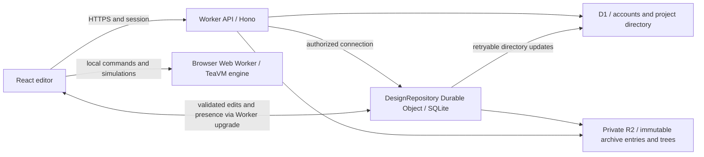

# Architecture and decision records

Read [the scope](README.md) first. These decisions are proposed for implementation, with feasibility conditions stated explicitly. Supersede a decision with its evidence and consequences rather than silently changing it. All production compute must remain in Workers or the user's browser.

The first [G1 executable evidence](g1-feasibility.md) now qualifies these decisions. It establishes bounded local/hosted proofs, not production readiness or full numerical/desktop parity.

## Runtime and data flow

One project initially represents one desktop `.ork` design, with multiple branches. One `DesignRepository` Durable Object owns that project's branch workspaces, command sequence, refs, commits, and project access policy. WebSocket branch subscriptions are multiplexed within that object. This co-locates the operations that need atomicity. It avoids a distributed transaction between a room object and a separate history/ref object. A very busy project may become a hotspot; measure it before adding sharding. Projects scale independently.

D1 owns accounts, sessions, global user roles/status, and a searchable directory of projects. A directory row is a projection, not authority to read a design. The repository object owns project memberships and content access; private R2 blobs are accessible only through checked Worker routes. The diagram's direct API-to-R2 path is for authorized upload/download orchestration, never an unchecked content-hash lookup.

## ADR-01: Build a browser frontend beside the desktop application

**Decision:** Add `web/` without replacing `core/` or `swing/`. Use React/TypeScript/Vite for an application served through Workers Static Assets and Hono for its API. Use npm workspaces with one lockfile; leave desktop Gradle behavior intact. Integrate the browser engine through a narrow, versioned facade.

**Reasoning:** Swing dialogs and AWT/LWJGL canvases are desktop UI, while much of the rocket model and physics is reusable. A new frontend is substantial work, but remote desktop hosting would violate the compute constraint and would not provide native shared editing. A server-rendered framework adds little to an interactive CAD-like workspace.

**Consequences:** Browser equivalents are needed for forms, rendering, printing, and shortcuts. Reuse domain logic and resources where practical; do not translate entire Swing packages. Keep schemas in `web/packages/contracts`, engine integration in `web/engine-adapter`, and UI logic outside the Java physics packages. These are proposed paths, not existing code.

Evidence: [repository architecture](../source/dev_guide/architecture.rst), `settings.gradle`, `swing/src/main/java/info/openrocket/swing/gui/`, [Cloudflare Vite integration](https://developers.cloudflare.com/workers/vite-plugin/), and [Hono Workers guide](https://hono.dev/docs/getting-started/cloudflare-workers).

## ADR-02: Adapt Java physics at build time; compute simulations in the browser

**Decision:** Try TeaVM's JavaScript target first, compiling a deliberately bounded Java facade. Run it in a dedicated browser Web Worker with progress and cancellation. Build a smaller entry point for authoritative command validation/application in the Workers runtime. Evaluate Wasm only against measured JavaScript limitations and supported browser/runtime features.

**Reasoning:** Reusing algorithms gives a better chance of parity than independently rewriting the simulator in TypeScript. Workers cannot directly execute the desktop JAR. Wasm support alone does not supply a JVM, AWT, JNI, Graal scripting, or Java reflection. The Java dependency graph must be adapted regardless of output format. [TeaVM documents these adaptation requirements](https://www.teavm.org/docs/intro/overview.html); [Workers Wasm support](https://developers.cloudflare.com/workers/runtime-apis/webassembly/) is a runtime capability, not proof that this core compiles.

**Consequences and G1:** Demonstrate component construction/editing, mass/CG/CP calculations, motor lookup, seeded flight simulation, file behavior, and a minimal shared command reducer using this checkout's algorithms. Test the validator in actual `workerd`, not only Node. Document each shim and why it preserves behavior. Keep a patch ledger with upstream symbols and differential tests. Reflection-based service registration may need generated registries; replace native database access with a versioned build-time catalog export rather than changing motor interpolation. CI may use a JVM to generate artifacts and reference results; production may not.

`startup/Application` and `CoreModule` contain process-global injector/preferences/catalog state. Worker isolates may serve multiple projects; never swap singleton preferences per request. Prove interleaved project/user isolation and request-local document state. Independent simulation jobs also need isolated models/configurations/caches; `Simulation.duplicateForIndependentSimulation()` documents why ordinary shared copies are unsafe.

Evidence: `build.gradle` targets Java 17; `core/src/main/java/module-info.java` requires `java.desktop`, `java.scripting`, and `java.sql`, plus Graal, Guice, and ClassGraph; `core/build.gradle` includes SQLite JDBC. The existing [MMRocket Sim port](https://github.com/mtnmanak/mmrocket-sim) is a reuse candidate, not an accepted dependency. Pin and audit any reused revision, retain notices, and compare 24.12-to-26.11 changes. No code was copied in this task.

**Alternatives:** A TypeScript physics rewrite has greater numerical divergence and maintenance risk, so it requires a new evidence-backed decision if the adaptation fails. A production JVM service or Container is outside scope. Shipping an old engine and claiming current parity is unacceptable. Failure of G1 blocks dependent delivery until a feasible plan within the constraint exists.

## ADR-03: Server-authoritative domain commands for real-time editing

**Decision:** Send typed commands, not raw XML replacements or arbitrary JSON patches. Use a deterministic reducer with domain validation, shared where possible between browser and Worker. A command identifies protocol/schema version, project, branch, workspace epoch, operation ID, observed sequence, target IDs, and touched-field preconditions. The server supplies author identity, sequence, time, and accepted effects.

Initial commands cover setting a supported field, adding/removing/moving a component, changing flight configuration or simulation settings, and replacing an asset. Complex gestures are atomic command batches. Preserve the Java model's constraints and derived effects; a generic property assignment must not bypass setter behavior. The G1 validator must demonstrate this boundary. If it cannot, do not accept client assertions that a design is valid.

For example, `BodyTube.setOuterRadius()` can change automatic-radius state, clamp thickness, clear a preset, and propagate to configuration listeners. Preconditions/conflict detection must account for the full read/write effect set, including derived changes, rather than only the field named in the command. Compare complete semantic snapshots with JVM execution.

**Reasoning:** A rocket is an ordered, constrained component graph. Concurrent operations that converge at the data-structure level can still create cycles, invalid parents, or broken motor/configuration references. A central authority simplifies permissions, validation, durable acknowledgment, and history consistency. CRDTs such as Yjs are not selected for the initial structured model. Full offline editing is not a stated requirement; adding it later needs explicit conflict semantics. Simultaneous text editing inside one description field can be reconsidered separately if observed usage justifies it.

**Conflict behavior:** Edits to independent fields can both succeed despite an older observed sequence if their preconditions still hold. Two edits to the same field report a conflict instead of silently overwriting. A deleted target rejects a stale edit. Competing tree moves recheck cycle/parent/order rules. A duplicate operation returns its original acknowledgment. New commands may not refer to objects that their session has not observed or introduced in the same batch. Concurrent insertion order is deterministic and visible.

**Persistence:** In one SQLite transaction, save accepted effects, the resulting workspace change, sequence, and deduplication result before acknowledgment. Broadcast only committed changes. Use explicit serialization and revision rechecks around asynchronous authorization/blob work; JavaScript's single thread does not make an entire async request atomic. Rebuild from a durable snapshot and command tail after eviction. Compaction retains deduplication information for the declared retry window; expired clients must resync rather than replay blindly. Hibernation must not erase connection identity or branch subscriptions. [Cloudflare's Durable Object guidance](https://developers.cloudflare.com/durable-objects/best-practices/rules-of-durable-objects/) supports the coordination choice and highlights interleaving/persistence concerns.

**Client behavior:** Apply optimistic edits locally, reconcile with accepted effects, and visibly retain rejected edits for retry or manual resolution. Resume using workspace epoch and last acknowledged sequence; receive a snapshot if the tail was compacted. Connection loss must never be labeled saved. Presence and selection are ephemeral, branch-specific, and excluded from history. Show names and selection outlines as well as a colorblind-safe palette.

Undo creates a compensating command with current preconditions. It must not restore a whole old snapshot over another user's changes. A branch reset/restore increments the workspace epoch so queued edits cannot apply to an unrelated design state.

## ADR-04: Version expanded desktop archives with loss-aware XML handling

**Decision:** Persist immutable file trees containing the exact archive paths and entry blobs, including `rocket.ork` XML, images, decals, embedded motor files, and safe opaque entries. Retain the original upload as a recovery object. Maintain a parsed loss-aware XML representation and typed editing projection; serialize only supported changes while preserving opaque data. Do not make Java load-save the sole storage codec.

The authoritative workspace is the loss-aware archive/XML state plus its identity sidecar. The typed model/engine state is a derived projection. Accepted command effects must update the authoritative state and any persisted projection consistently within the repository transaction; do not maintain independent JSON and XML truths. Cached projections must be reconstructible and checked against the authoritative revision.

**Reasoning:** `GeneralRocketSaver.saveAllPartsZipFile` writes `rocket.ork`, optional `preview.png`/`thumbnail.png`, decals, and `thrustcurves/<digest>.rse`. Keeping XML alone would lose design dependencies. Current Java import handlers warn and ignore some unknown data, so a successful parse does not establish lossless serialization. `GeneralRocketLoader.loadStep1` accepts plain XML, GZIP, or ZIP and currently dispatches from the first ZIP entry. Export must put `rocket.ork` first, even when other entries are sorted.

The source of truth for behavior is `core/src/main/java/info/openrocket/core/file/`, particularly `GeneralRocketLoader.java`, `GeneralRocketSaver.java`, and `openrocket/`. The current saver emits format 1.11 unconditionally; do not infer working older-version export from its comment about choosing the oldest suitable version. The [format reference](../source/dev_guide/file_specification.rst) is useful but does not replace the implementation.

**Canonicalization:** Define a versioned serializer in G1. Normalize only known syntax proven insignificant. Preserve element order, numeric precision, units, text, comments, namespaces, and unknown subtrees where needed for meaning or preservation. Do not sort component children, strip arbitrary whitespace, or hash an engine's lossy reserialization as the imported truth. For an unchanged import, offer the original bytes; changed exports need semantic equality, not identical ZIP compression metadata. Canonical known XML enables readable diffs; opaque edits compare exact bytes.

Reuse desktop component UUIDs and flight-configuration IDs. Do not use tree positions, names, or flight-configuration IDs as simulation identities. Assign stable web simulation IDs and archive-to-model identity mappings in a sidecar stored with revision metadata, outside the exported archive. Preserve these mappings through app branch/merge operations. Reimport from desktop may lose that sidecar; reconcile only unambiguous matches and surface ambiguity.

For legacy files missing component UUIDs, allocate identities once at import in the sidecar and persist them in subsequent edited standard exports. Preserve the untouched original. Duplicate/ambiguous component IDs block editing until an explicit repair resolves all references; do not silently pick the first match.

**Unknown content:** Preserve opaque fields and archive entries, and reject structural edits whose impact on them cannot be established. Unsupported versions/components may be stored/downloaded in preservation mode with a clear edit limitation. This is temporary data protection, not a claim of feature parity. Do not execute imported scripts automatically.

**Import bounds:** Enforce upload and expanded-size, entry-count, XML-depth, image-dimension, and per-operation limits chosen from the fixture corpus. Reject duplicate/ambiguous paths, traversal, external entities, and decompression bombs. Validate/harden image display and treat unknown attachments as downloads. Select ZIP/XML libraries only after preservation, streaming, and Workers compatibility tests; this plan deliberately fixes the codec contract before the package choice.

## ADR-05: Git-style commit graph, separated from autosave

**Decision:** Use immutable blobs/trees and a commit DAG, with named mutable branch refs. A commit records parent commit IDs, expanded tree hash, identity-sidecar hash, author, server time, message, format/schema versions, and captured workspace sequence. Hash versioned, length-delimited canonical encodings with SHA-256 and object-type domain separation. Scope object access and deduplication to a project initially.

**Reasoning:** This provides snapshots, ancestry, branches, merges, diffs, and revert without shelling out to Git or presenting compressed ZIP changes. Git wire protocol, GitHub sync, and clone/push/pull are not required for the selected interpretation of “Git-style”; they are not claimed as delivered features. Keep the format exportable so a later actual Git backend can be evaluated without changing desktop files.

**Commit protocol:** Capture immutable workspace sequence S and expected branch head H. Write and verify required R2 blobs/tree, then atomically insert the commit, advance the ref, and update the draft's base commit/committed sequence in the repository object's SQLite transaction if H still matches. Preserve the accepted command tail after S as uncommitted workspace changes. A failed ref comparison returns a conflict; it never overwrites a newer head. Persist a prepare record and operation ID for retries. A crash before ref publication leaves unreachable objects, not a visible partial commit. A crash after publication returns the recorded result on retry. D1 directory updates are a retryable outbox projection, never the commit transaction.

R2 provides [strongly consistent object operations](https://developers.cloudflare.com/r2/reference/consistency/), but it does not provide a transaction with repository SQLite or D1. Immutable object keys and the publish-after-write protocol are deliberate. Garbage collection must trace refs, retained originals, active/prepared snapshots, and merge candidates, using a grace period and serialization with commit preparation; bucket age alone is unsafe.

**Branches and merges:** Every branch has a committed head and a durable shared working draft. Branch creation starts at a selected commit. Branch switching preserves each branch's draft. Named commits capture the shared draft, including collaborators' accepted edits, with attribution in the command log. Checkout/restore cannot silently discard a dirty shared draft: save it as a recovery branch or explicitly resolve it before replacing the draft.

Three-way merge uses the commit DAG's common base and stable entity IDs. Merge independent field/asset changes; report edit/edit, delete/edit, incompatible parent moves, ordering ambiguity, and concurrent binary replacement. Opaque XML uses byte-level conflict detection unless a proven codec rule exists. Ambiguous/multiple merge bases require an explicit merge-base strategy rather than an arbitrary choice. Validate the entire resulting model and attachments before publication. A merge commit has two parents; conflict resolution is itself reviewed against a fixed target head/workspace sequence. Any change to that target requires recomputation. Revert creates a new commit; restore preserves ancestry and recovery data. No automatic force-push/reset behavior is selected.

## ADR-06: Application accounts, project roles, and administrators

**Decision:** Use Better Auth, its Drizzle SQLite adapter, D1, and the admin plugin. Prove the exact integration in G1. Start with administrator-provisioned email/password accounts, account settings/password changes, and administrator-issued recovery flows. This meets the requested account management without making an external email or identity service a runtime dependency. Self-service registration/email delivery is an unresolved product extension, not a hidden hosting prerequisite. Avoid bespoke password hashing or session cryptography.

**Reasoning:** An established authentication library supplies account/session lifecycle and user management while staying within the selected runtime. A managed external auth server would add a service dependency; Cloudflare Access alone does not define application ownership, membership, or history authorship. [Better Auth's adapter](https://better-auth.com/docs/adapters/drizzle), [Drizzle's D1 support](https://orm.drizzle.team/docs/sqlite/connect-cloudflare-d1), and [Better Auth's admin plugin](https://better-auth.com/docs/plugins/admin) establish building blocks, not a tested integration for this app.

**G1 conditions:** Exercise login/logout, password hashing within Worker budgets, CSRF/origin checks, session expiry/revocation, schema migrations, and concurrent admin operations with real D1 behavior. Use secure HTTP-only same-site cookies. Do not store auth tokens in URL query strings or browser local storage. Disable impersonation capabilities unless separately justified. One-time operator bootstrap identifies the first admin explicitly; never make the first public signup an admin. Recovery tokens must be short-lived, single-use, and delivered through an authenticated operator workflow.

Roles are global `user`/`admin` and project `owner`/`editor`/`viewer`. Owners manage sharing and ownership transfer; editors edit/commit/branch/merge; viewers read/export. Site admins manage accounts, roles, suspensions, sessions, and operational audit records; the role does not silently confer private project access. Protect the last active admin and last project owner; require transfer or an explicit lifecycle action before account deletion. Disable/revoke first; preserve immutable historical attribution without exposing unnecessary personal data. Deletion/retention policy needs a recorded product decision before release.

Authorize every route, WebSocket handshake, command, commit/ref change, and asset/result download on the server. Reject cross-project IDs regardless of their validity elsewhere. Project ACL changes serialize in the owning object and close affected sockets. Check session/global account status using authoritative primary-backed D1 reads for commands; do not depend on an eventually consistent auth cache. If replicas are introduced, use [D1's session consistency controls](https://developers.cloudflare.com/d1/worker-api/d1-database/) deliberately. Define revocation's linearization point: in-flight operations already authorized may finish, but after revocation acknowledgment no newly authorized mutation may succeed. Test the race, including suspended users with open sockets. Failed checks fail closed.

## ADR-07: Keep simulations separate from trusted design state

**Decision:** Run browser simulations from an immutable input snapshot. Record tree/input hash, engine build, motor/material catalog versions, simulation options, random seed, and relevant extension/expression versions. Publish output as an optional derived artifact referenced by this provenance; current design and history remain independently editable.

**Reasoning:** Long numerical work would stall a collaboration object and consume shared server budgets. Browser jobs can progress and cancel independently. A result computed by a browser is untrusted as a scientific assertion even if its upload schema is valid. Label its author and provenance; do not present it as a server-certified result. Reject results whose project access or input reference is invalid. Mark results stale when inputs change and prevent a late completion from attaching itself to the current design incorrectly.

**Consequences:** Browser closure pauses/cancels work; unattended cloud computation is not available in this architecture. Parallel simulations/optimization use bounded browser workers and resume/checkpoint only if required by the existing workflow. Shared derived results may be cached by all relevant input/version hashes, but validation, size limits, and attribution still apply. Existing stored flight data, including external measurements, must survive import/export even when not regenerated; it is not automatically disposable cache. Server-side trusted numerical verification would require a separate decision and must fit Workers limits.

## ADR-08: Browser rendering and advanced-feature parity

**Decision:** Use SVG for 2D views/templates and Three.js/WebGL2 for interactive 3D, with geometry/model data derived from the engine adapter. Use browser PDF/print/download workflows as functional equivalents of desktop save/print dialogs. Keep animation/rendering separate from canonical model state; retain desktop-only appearance settings in the file codec.

**Reasoning:** The current renderer is in Swing, with AWT/LWJGL/OpenGL dependencies. It cannot simply become a browser canvas. Geometry, appearances, decal placement, clipping, picking, Photo Studio, transparent export, and model export all need explicit parity checks. UI colors must vary lightness and use labels/shapes as well as hue.

Scripting, custom expressions, built-in extensions, arbitrary third-party Java plugins, and local/native integrations are separate parity risks. `JavaCode` dynamically loads listener classes; `GraalJSScriptEngineFactory` permits unrestricted Java host access. Neither behavior transparently transfers to a TeaVM bundle or ordinary browser JavaScript. Custom expressions use a different evaluator and need separate tests. Preserve the desktop rule that untrusted imported scripts are disabled.

No arbitrary script/plugin may run with session/network/storage capabilities. A same-origin Web Worker alone is not a security sandbox: it can access origin resources. Investigate a separately isolated origin or a proven capability sandbox with controlled communication, network restrictions, trust prompts, cancellation, and resource bounds; its design and semantic compatibility remain open G1/G6 work. Preservation of plugin XML alone is not execution parity. At G1 classify each mechanism; at G6 every requested capability must have a working equivalent or an explicitly agreed requirement change. Do not silently redefine “full parity” to exclude hard features.

## ADR-09: Deploy and operate within measured platform budgets

**Decision:** Deploy Worker/assets, D1 migrations, SQLite-backed Durable Object migrations, and private R2 bindings through Wrangler and CI. Keep development, staging, and production data/secrets separate. Use structured logs for operation IDs, rejection reasons, reconnects, latency, errors, and resource usage without logging design contents or credentials. Avoid extra queues, KV caches, or workflow services until a measured requirement justifies them.

**Reasoning:** The selected application needs bounded synchronous editing and storage coordination. Background simulation infrastructure would add scope and violate the intended browser-compute boundary. Current [Workers limits](https://developers.cloudflare.com/workers/platform/limits/) include finite CPU, isolate memory, startup, and package budgets. Browser assets and the small validation entry point have different budgets; do not bundle the whole simulator into every server request.

**Release conditions:** Measure validator startup/CPU/memory, XML import/export sizes, room command rate, connections/fanout, history growth, and per-user/project storage cost on the target plan. Set documented limits from measured fixtures and desired workload. A slow collaborator must not create unbounded broadcast buffers. Record cost assumptions and forecast before selecting a production plan; no paid plan was authorized or provisioned by this task. Backups must cover D1, repository state, R2 blobs, and their cross-store references together. Restore exercises must establish consistent refs and retry pending writes; provider backups alone are not proof of application recovery. Use additive migrations/protocol negotiation, compatible rollout sequencing, and a tested rollback procedure.

## ADR-10: Keep the successful G1 subsets isolated until the remaining gate evidence exists

**Decision:** Retain executable proof packages beside the desktop build, with one npm workspace/lockfile and a separate TeaVM/ASM Gradle adapter. Keep the pinned current model/physics classfiles as inputs, a smaller server reducer entry point, and explicit startup/document/API bridges with a reuse ledger. Do not adopt the older port's complete numerical core. Keep file bytes/XML plus sidecar separate from the engine projection. The ordinary Worker has no operator setup route; disposable hosted testing uses a distinct protected, one-time harness and fresh storage bindings.

**Evidence and reasoning:** Current-core browser flights and Worker setters now execute, and an adapted-JVM diagnostic matches the original JVM transcript exactly for the covered fixture. Browser flights have small recorded differences, so compilation alone cannot establish parity. A lexical component-name edit preserves current archives through actual desktop loader/saver round trips. Better Auth with its separate Drizzle adapter, D1, private R2 and SQLite DOs passed local workerd and isolated hosted checks. This supports retaining the selected approach while holding G1 for missing preset/configuration/preference, catalog/extension, numerical and memory evidence.

**Alternatives and consequences:** A wholesale copy of the 24.12 port would change the baseline; a TypeScript physics rewrite introduces a separate correctness burden; a JVM service or Container violates the compute constraint. None is adopted. The existing port's GPL bridge patterns are explicitly attributed, and non-equivalent collation/defaults/plugins are listed rather than hidden. Protocol/codec version 1 applies only to the bounded interfaces; future compatibility changes need explicit migration decisions. No production schema or deployment foundation is established by these experimental SQLite tables.

**Runtime pins and budgets:** Tested versions are in `web/package-lock.json`, including TeaVM 0.15.0 in the isolated Gradle build, Wrangler 4.164.0, workerd 1.20261117.1 and compatibility date 2026-11-17, Better Auth/adapter 1.7.25, Drizzle 0.45.4, Hono 4.13.19, fflate 0.8.3 and saxes 6.0.0. The installed Cloudflare test integration is `@cloudflare/vitest-plugin` 1.8.4 with Vitest 4.1.12. Hosted password login used 117–166 ms CPU with default hashing, so a 10 ms CPU budget is not established. Do not reduce the hash work factor to fit that budget. Heap measurements and dependency advisory resolution remain pending before delivery. Exact commands, failed inputs and cleanup evidence live in the [combined record](g1-feasibility.md) and package READMEs.

## ADR-11: Review two file-I/O fixes without changing the numerical baseline

**Context and decision:** The supplied real-world rocket exposed warning-type data loss and RSE numeric rounding that invalidates embedded motor digests. Apply the narrow desktop fixes `40dd387ce` and `3648d87bd`, with regression tests, while retaining the original numerical baseline. The engine build checks exact SHA-256 values for those two files and continues rejecting differences in every other core source. Its manifest explicitly records the baseline and reviewed file/commit hashes; the desktop proof also records these source hashes. This is the necessary integration delta for the requested bug fixes, not a wholesale baseline upgrade.

**Evidence and alternatives:** Both warning-name cases and all four new precision cases failed before their respective fixes; 47 relevant core tests pass afterward. The browser/reducer artifact hashes and complete numerical JVM transcript remain identical to the original proof, and Chromium/workerd assertions pass. Negative probes confirm the pin rejects edits both inside and outside the reviewed files. Dropping source checks would hide future changes; changing the desktop reference without this delta review would obscure comparisons. Neither alternative is adopted. Details are in [the compatibility evidence](../../web/packages/ork-format/README.md#warning-and-motor-precision-fixes).

**Consequences:** Previously rounded motor archives still require the original matching motor source/catalog to recover lost precision. No fuzzy digest match or unverified motor substitution is introduced. Desktop saves may emit different RSE bytes, so the proof records their hashes and verifies numerical motor equivalence; web archive edits continue to preserve attachment bytes exactly. G1 remains held for its other documented gaps.

## ADR-12: Bound imported preset and configuration effects to explicit supported projections

**Decision:** Extend the existing G1 Java reducer and authenticated archive transaction with two actual preset catalog records and one parachute deployment reset. Reconstruct request-local core objects, run original methods, and preserve XML outside accepted effect spans. Unknown catalog digests, automatic geometry dependencies in the preset path, incomplete/opaque deployment overrides and unresolved configuration references refuse the operation. The strict source pin and two exact I/O exceptions remain unchanged.

**Evidence and scope:** The [executable proof](../../web/platform-proof/README.md#imported-preset-and-configuration-proof) compares actual attached desktop presets and the desktop recovery-reset action with workerd, including complete relevant states, targeted configuration modification IDs, full desktop serialization and lexical archive preservation. A preset digest build failure required an MD5-only `MessageDigest` compatibility bridge; JDK/Node/workerd vectors and real factory-validated records check it. Its classfile remapping is a recorded adapter change, not a desktop source edit or relaxed digest check. The missing computed-thickness failure is retained as well.

**Alternatives and consequences:** A preset-present flag would miss actual load/clear semantics; changing only an override field would miss inheritance and event scoping. Neither is used. A full imported graph/catalog/startup adaptation remains a larger investigation. This bounded implementation keeps globals immutable and production within Workers/storage; simulations remain browser work. Mutable preference isolation, general extension execution, other configuration operations and hosted CPU/heap budgets remain open, so G1 stays held.
